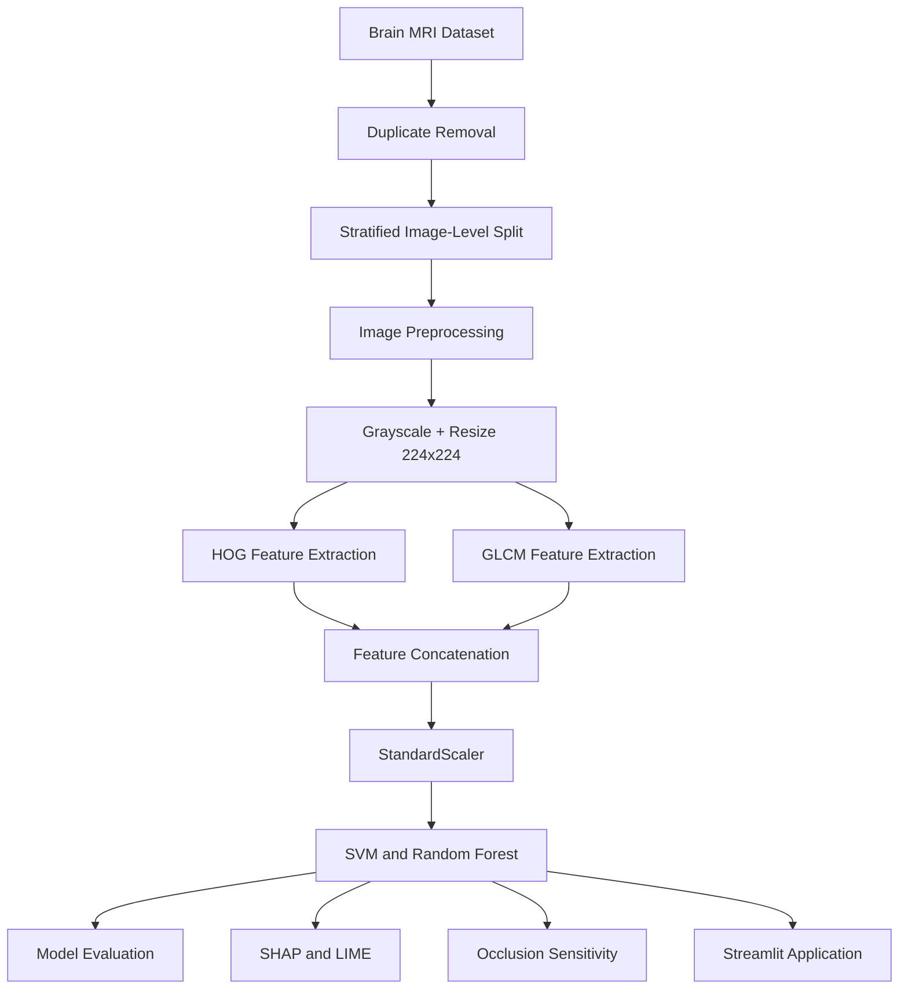

# Brain Tumor Classification using Computer Vision and Traditional Machine Learning

An MRI-based brain tumor classification system built using handcrafted feature extraction and traditional machine learning algorithms, with an interactive Streamlit application and Explainable AI techniques.

<p align="center">
  <strong>HOG + GLCM | SVM | Random Forest | SHAP | LIME | Occlusion Sensitivity | Streamlit</strong>
</p>

---

## 1. Project Overview

Brain tumors are abnormal growths of cells in or around the brain. Early examination and accurate interpretation of brain MRI scans are important parts of clinical assessment.

This project explores the classification of brain MRI images into four categories using Computer Vision and Traditional Machine Learning.

Unlike CNN-based approaches, this implementation uses handcrafted image features extracted using:

- Histogram of Oriented Gradients (HOG)
- Gray-Level Co-occurrence Matrix (GLCM)

The extracted features are used to train and evaluate two machine learning classifiers:

- Support Vector Machine (SVM)
- Random Forest

The project also explores Explainable AI methods to investigate which features and image regions influence model predictions.

An interactive Streamlit application allows users to upload MRI images and view classification results and an occlusion-based explanation.

### Classification Categories

1. Glioma
2. Meningioma
3. Pituitary Tumor
4. No Tumor

---

## 2. Medical Background

A brain tumor is an abnormal growth of cells in or around the brain. Brain tumors can be classified in different ways, including by their origin, biological behaviour and anatomical location.

MRI is commonly used to examine brain structures and abnormalities because it provides detailed soft-tissue images.

### A. Glioma

Gliomas are tumors that arise from glial cells, which support and protect nerve cells in the central nervous system.

Their appearance on MRI can vary depending on the tumor type, grade and other characteristics.

### B. Meningioma

Meningiomas originate from the meninges, the protective membranes surrounding the brain and spinal cord.

They are often located outside the brain tissue itself and can have different imaging appearances depending on their size and location.

### C. Pituitary Tumor

Pituitary tumors develop in or around the pituitary gland, a small gland located at the base of the brain.

Some pituitary tumors can affect hormone production or surrounding structures.

MRI is useful for examining the pituitary region and identifying structural abnormalities.

### D. No Tumor

This category represents MRI images labelled as not containing any of the three target tumor categories in the dataset.

A model prediction of No Tumor does not establish that a patient is medically healthy.

### Category Comparison

| Category | Origin / Location | Description |
|---|---|---|
| Glioma | Glial cells | Tumors arising from glial cells |
| Meningioma | Meninges | Tumors arising from protective brain membranes |
| Pituitary | Pituitary gland | Tumors developing in or around the pituitary gland |
| No Tumor | No target tumor label | Images labelled as not containing the target tumor categories |

---

## 3. Dataset

The dataset contains brain MRI images belonging to four classes.

### Dataset Statistics

| Parameter | Value |
|---|---:|
| Total unique images | 6,726 |
| Training images | 5,380 |
| Testing images | 1,346 |
| Training split | 80% |
| Testing split | 20% |
| Random state | 42 |
| Image dimensions | 224 × 224 |
| Number of classes | 4 |

### Test Set Distribution

| Class | Images |
|---|---:|
| Glioma | 324 |
| Meningioma | 327 |
| No Tumor | 347 |
| Pituitary | 348 |
| **Total** | **1,346** |

### Duplicate Removal and Data Splitting

The original dataset contained separate Training and Testing folders.

Exact duplicate images across these folders were identified using SHA-256 hashing.

A total of 79 exact duplicate images were removed.

The resulting unique dataset was divided using a stratified 80:20 image-level split with random state 42.

Stratification helps preserve class proportions across training and testing sets.

**Evaluation limitation:** This is an image-level split, not a patient-level split. Patient-level generalization has not been established. Multiple images from the same patient may still exist across the two subsets.

The original MRI dataset is not included in this repository.

---

## 4. Image Preprocessing

Each MRI image passes through the following preprocessing steps:

1. Image loading
2. Grayscale conversion
3. Resizing to 224 × 224
4. HOG feature extraction
5. GLCM feature extraction
6. Feature concatenation
7. StandardScaler transformation
8. Machine learning classification

Grayscale conversion provides intensity information for texture analysis and simplifies the feature extraction pipeline.

Resizing ensures consistent image dimensions.

StandardScaler is fitted using training data only and then applied to both training and testing features to avoid data leakage.

---

## 5. Feature Extraction

This project combines structural and texture-based information using HOG and GLCM.

### A. Histogram of Oriented Gradients (HOG)

HOG extracts information based on image gradients and edge orientations.

It divides the image into small cells, calculates orientation histograms and combines them into feature descriptors.

These descriptors capture local structural and shape information.

Configuration:

```python
hog(
    img,
    orientations=9,
    pixels_per_cell=(16, 16),
    cells_per_block=(2, 2),
    feature_vector=True
)
```

Features extracted per image: **6,084**

### B. Gray-Level Co-occurrence Matrix (GLCM)

GLCM captures spatial relationships between grayscale pixel intensities.

It helps describe texture patterns through the frequency of neighbouring intensity combinations.

Configuration:

```python
glcm = graycomatrix(
    img,
    distances=[1, 2],
    angles=[0, np.pi/4, np.pi/2, 3*np.pi/4],
    levels=256,
    symmetric=True,
    normed=True
)
```

The following properties are extracted:

- Contrast
- Dissimilarity
- Homogeneity
- Energy
- Correlation
- ASM (Angular Second Moment)

For every property, the mean and standard deviation are calculated across the distance-angle combinations.

Features extracted per image: **12**

### C. Combined Feature Vector

| Feature Type | Number of Features |
|---|---:|
| HOG | 6,084 |
| GLCM | 12 |
| **Total** | **6,096** |

Combining HOG and GLCM allows the classifiers to use both structural and texture-related image information.

---

## 6. Machine Learning Models

Two traditional machine learning algorithms were evaluated.

### A. Support Vector Machine (SVM)

SVM is a supervised learning algorithm that identifies decision boundaries between classes.

The RBF kernel allows the classifier to model nonlinear relationships between extracted features.

The RBF-kernel SVM achieved the best test performance in this experiment.

### B. Random Forest

Random Forest is an ensemble learning algorithm that combines predictions from multiple decision trees.

Each tree learns from sampled training data and considers subsets of features.

Random Forest was used as a comparative classifier and for exploratory SHAP feature analysis.

### Model Comparison

| Model | Test Accuracy | Training Time |
|---|---:|---:|
| SVM (RBF) | **93.24%** | **93.09 seconds** |
| Random Forest | 91.75% | 121.11 seconds |

SVM was selected as the primary model because it achieved higher test accuracy and lower training time in this experiment.

These results apply to this particular dataset and evaluation setup and do not establish universal model superiority.

---

## 7. Classification Report

The following report represents SVM performance on the held-out test set.

```text
              precision    recall   f1-score   support

      glioma       0.98      0.89      0.93       324
  meningioma       0.83      0.91      0.87       327
     notumor       0.98      0.95      0.96       347
   pituitary       0.95      0.98      0.97       348

    accuracy                           0.93      1346
   macro avg       0.93      0.93      0.93      1346
weighted avg       0.94      0.93      0.93      1346
```

### Understanding the Metrics

- **Precision:** How many predictions for a class were correct.
- **Recall:** How many actual images of a class were correctly identified.
- **F1-score:** The harmonic mean of precision and recall.
- **Support:** Number of actual test images belonging to a class.

Meningioma has the lowest precision (0.83), indicating that a noticeable proportion of images predicted as meningioma belong to other classes.

Glioma recall is 0.89, meaning some actual glioma images were classified as other categories.

These class-level results highlight why accuracy alone is not sufficient for evaluating medical image classification systems.

---

## 8. Explainable AI

Three explainability approaches were explored.

### A. SHAP

SHAP stands for SHapley Additive exPlanations.

It uses Shapley-value-based feature attribution to explain how features contribute to model predictions.

In this project, SHAP was used with the Random Forest model to explore feature importance.

Exploratory results from 20 test samples:

| Feature Group | Average Per-Feature Importance |
|---|---:|
| HOG | 0.000106609 |
| GLCM | 0.002350635 |

GLCM showed higher average importance per individual feature in this exploratory analysis.

However, HOG contains 6,084 features while GLCM contains only 12. Per-feature importance should not be confused with total feature-group importance.

These results are exploratory and based on a small sample.

### B. LIME

LIME stands for Local Interpretable Model-agnostic Explanations.

It explains individual predictions by examining how model outputs change when parts of an input are perturbed.

In this project, LIME was used to visualize image regions that influenced a selected prediction.

The highlighted regions indicate model-influential areas, not tumor segmentation.

### C. Occlusion Sensitivity

Occlusion Sensitivity investigates how predictions change when selected image regions are covered or replaced.

Implementation configuration:

- Patch size: 32 × 32
- Stride: 16
- Overlapping patch scores are averaged.

The resulting heatmap highlights regions where occlusion changes the model's output.

This technique provides insight into the image regions influencing the prediction.

It does not generate a tumor mask or prove that the model focuses on medically meaningful tumor tissue.

---

## 9. Application

The project includes a Streamlit application.

### Features

- MRI image upload
- Image preview
- Four-class classification
- Normalized SVM decision score visualization
- Occlusion Sensitivity heatmap

The application uses the trained SVM model and StandardScaler stored in a Joblib artifact hosted on Hugging Face Hub.

The displayed normalized decision scores are obtained by applying softmax to SVM decision values. They are **not calibrated probabilities**.

---

## 10. Project Architecture



---

## 11. Tech Stack

| Technology | Purpose |
|---|---|
| Python | Core programming |
| OpenCV | Image preprocessing |
| NumPy | Numerical operations |
| Scikit-image | HOG and GLCM extraction |
| Scikit-learn | Feature scaling and ML models |
| SVM | Primary classifier |
| Random Forest | Comparative classifier |
| SHAP | Feature attribution |
| LIME | Local explanations |
| Matplotlib | Visualization |
| Streamlit | Web application |
| Hugging Face Hub | Model hosting |
| Joblib | Model serialization |
| Google Colab | Development environment |

---

## 12. Repository Structure

```text
Brain-Tumor-Classification/
│
├── app.py
├── requirements.txt
├── README.md
├── .gitignore
├── LICENSE
│
├── notebooks/
│   └── Brain_Tumor_Classification.ipynb
│
├── docs/
│   ├── MEDICAL_BACKGROUND.md
│   ├── METHODOLOGY.md
│   ├── MODEL_EVALUATION.md
│   ├── EXPLAINABLE_AI.md
│   └── DEPLOYMENT_GUIDE.md
│
├── assets/
└── screenshots/
```

The trained model is hosted separately on Hugging Face Hub and is downloaded by the application when required.

---

## 13. Installation and Usage

Clone the repository:

```bash
git clone https://github.com/YOUR_USERNAME/Brain-Tumor-Classification.git
cd Brain-Tumor-Classification
```

Install dependencies:

```bash
pip install -r requirements.txt
```

Run Streamlit:

```bash
streamlit run app.py
```

The application downloads the model from Hugging Face Hub when it starts.

---

## 14. Deployment

The application can be deployed using Streamlit Community Cloud.

General workflow:

1. Push the project repository to GitHub.
2. Open Streamlit Community Cloud.
3. Connect your GitHub account.
4. Select the Brain-Tumor-Classification repository.
5. Select `app.py` as the main application file.
6. Deploy the application.

The model is hosted separately on Hugging Face Hub, so it does not need to be committed to GitHub.

---

## 15. Limitations

This project is an experimental machine learning prototype.

Important limitations:

- The dataset was divided using an image-level split, not a patient-level split.
- Patient-level generalization has not been established.
- External dataset validation has not been performed.
- The model has not undergone clinical validation.
- The model does not perform tumor segmentation.
- The model does not classify tumor grade or stage.
- Normalized decision scores are not calibrated medical probabilities.
- MRI scanners, image quality and acquisition protocols may affect performance.
- Explainability visualizations do not establish clinical reasoning.

---

## 16. Future Improvements

Potential future improvements include:

- Patient-level data splitting.
- External dataset validation.
- Hyperparameter optimization.
- Prediction score calibration.
- More extensive explainability analysis.
- Evaluation by medical imaging professionals.
- Comparison with CNN-based feature extraction approaches.

---

## 17. Disclaimer

This project is developed for educational and research purposes only.

It is not a clinically validated diagnostic system and must not be used for medical diagnosis, treatment decisions or clinical assessment.

All predictions and visual explanations are experimental outputs from a machine learning model.

A qualified medical professional must interpret MRI scans and make clinical decisions.

---

## 18. Acknowledgements

This project was developed as a hands-on exploration of Computer Vision, feature engineering, traditional machine learning, Explainable AI and application deployment.

Special emphasis was placed on understanding the complete pipeline, from MRI preprocessing and handcrafted feature extraction to classification, evaluation and model interpretation.
